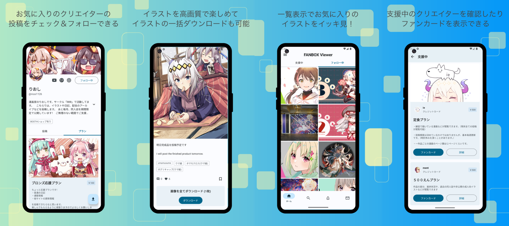
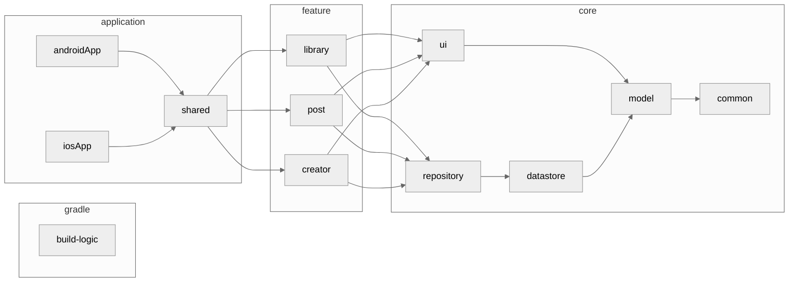

<h1 align="center">PixiView</h1>

<p align="center">
PixiView で快適な FANBOX ライフを！<br>
PixiView は PIXIV FANBOX の非公式 Android & iOS クライアントアプリです
</p>

<div align="center">
  <a href="./LICENSE">
    
  </a>
  <a href="">
    
  </a>
  <a href="https://open.vscode.dev/matsumo0922/PixiView">
    
  </a>
</div>

<hr>

<p align="center">
    
</p>


## Status
#### Ready!! :rocket:

GooglePlay または AppStore にて公開中です！下記のリンクからダウンロードしてください。
また、モバイルアプリ開発者の方はアプリをビルドして、自分でインストールすることもできます。
コントリビュートはいつでも歓迎です。下のセクションに従ってアプリをビルドしてみてください。

#### [Download](https://apps.apple.com/jp/app/fanviewer/id6476085758) from AppStore
#### [Download](https://play.google.com/store/apps/details?id=caios.android.fanbox) from GooglePlay
#### [Download](https://github.com/matsumo0922/PixiView-KMP/releases) from GitHub

## Why?

FANBOX には Web 版しかなく、スマートフォンで投稿を閲覧するには少し不便だったからです。スマートフォン向けアプリとしてネイティブで開発することによって、投稿のダウンロード機能や新着通知などの便利な機能を複数搭載できました。

## Tech Stack

- [Kotlin](https://kotlinlang.org/)
- [Kotlin Coroutines](https://kotlinlang.org/docs/coroutines-overview.html)
- [Kotlin Flow](https://kotlinlang.org/docs/flow.html)
- [Kotlin Multiplatform](https://www.jetbrains.com/ja-jp/kotlin-multiplatform/)
- [Jetpack Compose](https://developer.android.com/jetpack/compose?hl=ja)
- [Jetpack Compose Multiplatform](https://www.jetbrains.com/ja-jp/lp/compose-multiplatform/)
- [Material3](https://m3.material.io)

## Feature
#### Ready!!

- FANBOX
  - フォローしているクリエイターの投稿を時系列順に表示
  - 支援しているクリエイターの投稿を時系列順に表示
  - フォローしているクリエイターを表示
  - 支援しているクリエイターを表示
  - クリエイターのフォロー / フォロー解除
  - 投稿のいいね
  - クリエイター検索
  - タグ検索
  - プラン検索
  - 通知の表示
  - メッセージの表示
- ダウンロード
  - 画像 / ファイル / GIF 形式でダウンロード
  - 投稿に含まれるすべての画像をダウンロード
  - ファンカードのダウンロード
  - クリエイター単位での一括ダウンロード機能
- 広告
  - AdMob Native 広告

#### Not Ready...

- Pixiv 連携機能
- ウィジェット機能

## Architecture
アプリのアーキテクチャ図を示します。 だいぶ複雑になっているので、一部のモジュールや依存関係は省略し、概略を掴める形にしています。



## 静的解析

静的解析は detekt 2.0.0-alpha.6、ktlint wrapper、Compose rules 0.6.8 を使う。
root と `build-logic` の Kotlin ファイルおよび各モジュールの Kotlin ファイルを、次のコマンドで確認する。

```bash
./gradlew detekt reportMerge --continue
./gradlew :androidApp:lintDebug
```

自動整形には `./gradlew detekt --auto-correct --continue` を使い、続けて自動修正を付けないコマンドを実行する。
統合した Checkstyle レポートは `build/reports/detekt/merge.xml`、モジュールごとの HTML レポートは各モジュールの `build/reports/detekt/detekt.html` に出力する。
統合対象は通常の `detekt` の結果で、型解決タスクの結果は混ぜない。

関数定義の改行は、引数が3つ以上、またはデフォルト引数を持つ場合に引数ごとに改行する。
`FunctionSignature` はデフォルト引数の有無を判別しないため無効にし、この規約は手動で確認する。
呼び出し側の名前付き引数、引数ごとの改行、Modifier の先頭配置も手動レビューの対象となる。
行長は折り返しの基準にしない。

関数数の上限は interface が60、class が30で、override とテストケースを数えない。
Repository の公開 API を保ったまま責務を確認するための閾値とする。
Composable は宣言的な UI の分岐を含むため `CyclomaticComplexMethod` の対象外とし、複合条件の分割は `ComplexCondition` で確認する。
`ModifierMissing` は public、internal、private を対象とし、Preview を除外する。

型情報が必要なルールは `:core:model:detektMainAndroid` などのタスクで確認する。
これらのタスクは detekt が生成した source set の範囲を使う。
KMP の `expect` / `actual` に関する解析エラーが出る場合は、型解決付きルールの結果を個別に検証し、実際のコンパイル結果と区別する。

## Contribute

このアプリは Gradle の Convention Plugins を用いてビルドのロジックを共通化しており、`build-logic` というモジュールに全てのロジックが記述されています。このアプローチに関しては、[nowinandroid](https://github.com/matsumo0922/nowinandroid/tree/main/build-logic) をご覧ください。

何か不具合を発見したり機能を改善したい場合、機能を新たに開発したい場合は、まず issue を書いてください。その上であなた自身を assign し、開発に取り組んでください。pull request はいつでも歓迎です :smile:

このアプリは AdMob を用いて収益化しています。GitHub から手動でビルドする際は AdMob App ID を `local.properties` に記述する必要があります。デフォルトではダミーの ID が入っているため、起動時にクラッシュします。もしくは AdMob の当該コードを削除してからアプリをビルドしてください。その他、 `local.properties` には様々な ID が記述されています。詳細は `androidApp/build.gradle.kts`、`shared/build.gradle.kts`、`core/common/src/commonMain/kotlin/me/matsumo/fanbox/core/common/PixiViewConfig.kt` をご覧ください。

## License

```text
PixiView
Copyright 2025 daichi-matsumoto

Licensed under the Creative Commons NonCommercial License (the "License");
you may not use this file except in compliance with the License.
You may obtain a copy of the License at

https://creativecommons.org/licenses/by-nc/4.0/

Unless required by applicable law or agreed to in writing, software
distributed under the License is distributed on an "AS IS" BASIS,
WITHOUT WARRANTIES OR CONDITIONS OF ANY KIND, either express or implied.
See the License for the specific language governing permissions and
limitations under the License.
```
